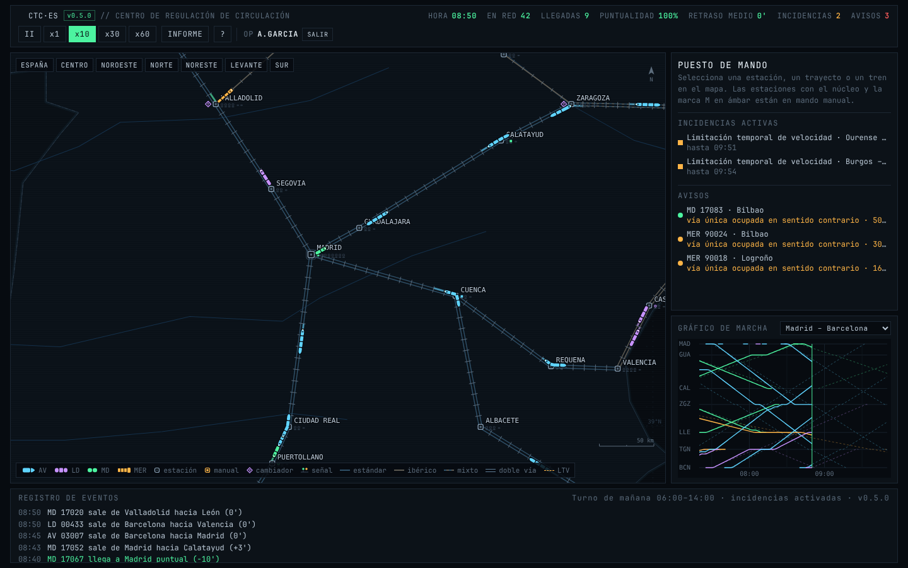
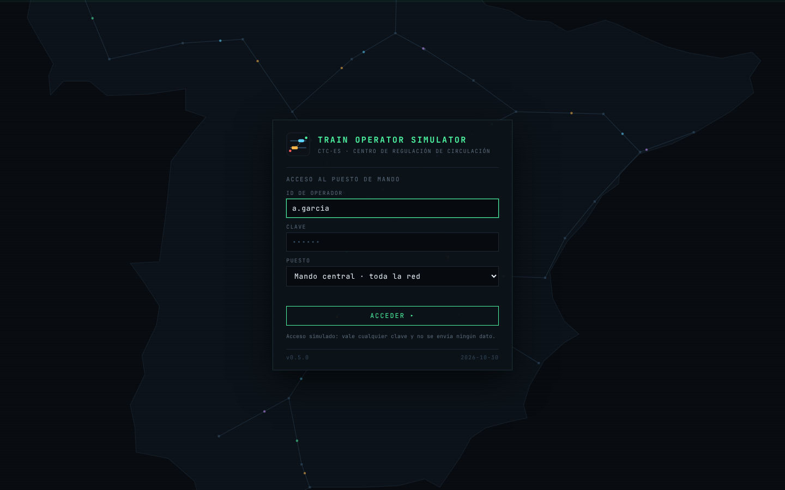

# Train Operator Simulator

**CTC·ES v0.5.0** · Simulador de regulación de tráfico ferroviario sobre la red española.

Tomas el puesto de un centro de regulación de circulación: una pantalla oscura de terminal con la red esquemática de España, señales, cantones y trenes de colores. Tu trabajo es que unas 270 circulaciones diarias lleguen a su hora pese a la vía única, los cambios de ancho y las incidencias.

## Características

- **Red española** con 31 estaciones reales, líneas de doble vía y de vía única, y anchos estándar, ibérico y mixto.
- **Señalización por cantones** de unos 12 km, con aspectos verde, amarillo y rojo y curva de frenado de cada tren.
- **Estaciones** con vías con andén (V) y vías de apartado (A), paso por vía general para los trenes que no paran y cambiadores de ancho.
- **Horario** con cuatro tipos de tren: alta velocidad, larga distancia (ancho variable), media distancia y mercancías.
- **Mando AUTO o MANUAL** por estación: asignación de vías, orden de paso, orden de salida y retención de trenes.
- **Incidencias**: limitaciones temporales de velocidad, fallos de circuito de vía con orden de rebase, averías de tren y atención a viajeros.
- **Gráfico de marcha** por corredor, con el horario previsto y la marcha real.
- **Turnos** de mañana, tarde o jornada completa, e **informe de fin de turno** descargable.

## Cómo jugar

1. Identifícate en la pantalla de acceso con tu ID de operador, cualquier clave y el puesto que quieras (el acceso es simulado).
2. Elige turno y si quieres incidencias, y pulsa **TOMAR EL TURNO**.
3. Vigila los **avisos** (círculos rojos en el mapa y lista del panel): trenes que esperan una orden o llevan más de 10 minutos parados.
4. Pulsa una **estación** para ver sus vías y los trenes que llegan; pásala a **MANUAL** si quieres decidir tú vías y salidas.
5. **Retén** trenes lentos para que adelanten los rápidos y ordena los cruces en vía única.
6. Ante un **fallo de circuito de vía**, autoriza el **rebase** para que los trenes pasen a 30 km/h.
7. Al terminar el turno revisa el **informe**: puntualidad (llegadas con 5 minutos de retraso o menos), retraso medio y calificación.

El manual completo está dentro del juego (tecla `H`).

### Atajos de teclado

| Tecla | Acción |
| --- | --- |
| Espacio | Pausa / reanudar |
| `+` `-` `0` | Ampliar, reducir, ver toda España |
| `I` | Informe del turno |
| `H` | Manual de operación |
| `Esc` | Cerrar ventana o quitar selección |

## Jugar sin conexión

- **Desde la web**: tras la primera visita el simulador queda guardado en el navegador y funciona sin conexión. El pie de la pantalla de acceso indica «disponible sin conexión». En el móvil o en Chrome/Edge se puede **instalar como aplicación** (menú del navegador → *Instalar* o *Añadir a pantalla de inicio*).
- **En local**: descarga el repositorio y abre `index.html`; no necesita internet ni servidor.

## Ejecutar en local

No hay dependencias ni compilación: abre `index.html` en un navegador moderno.

## Publicar en GitHub Pages

En el repositorio, **Settings → Pages → Deploy from a branch**, rama `main`, carpeta `/ (root)`. El simulador quedará en `https://<usuario>.github.io/train-operator-simulator/`.

## Estructura

| Archivo | Contenido |
| --- | --- |
| `index.html`, `style.css` | Interfaz del puesto de mando |
| `js/data.js` | Estaciones, líneas, anchos, tipos de tren, plan de servicios y corredores |
| `js/version.js` | Nombre y versión de la aplicación |
| `js/sim.js` | Simulación: cantones, frenado, reservas de vía, vía única, ancho de vía, incidencias, horario y turnos |
| `js/ui.js` | Mapa, cámara y entrada |
| `js/panels.js` | Paneles de estación, trayecto y tren; gráfico de marcha; inicio, manual e informe |
| `js/login.js` | Pantalla de título, acceso de operador y secuencia de carga |
| `js/main.js` | Arranque y registro del modo sin conexión |
| `sw.js`, `manifest.webmanifest`, `icons/` | Modo sin conexión e instalación como aplicación |

## Versiones

Consulta [CHANGELOG.md](CHANGELOG.md). Para publicar una versión nueva, actualiza `js/version.js` y añade su entrada al changelog.
